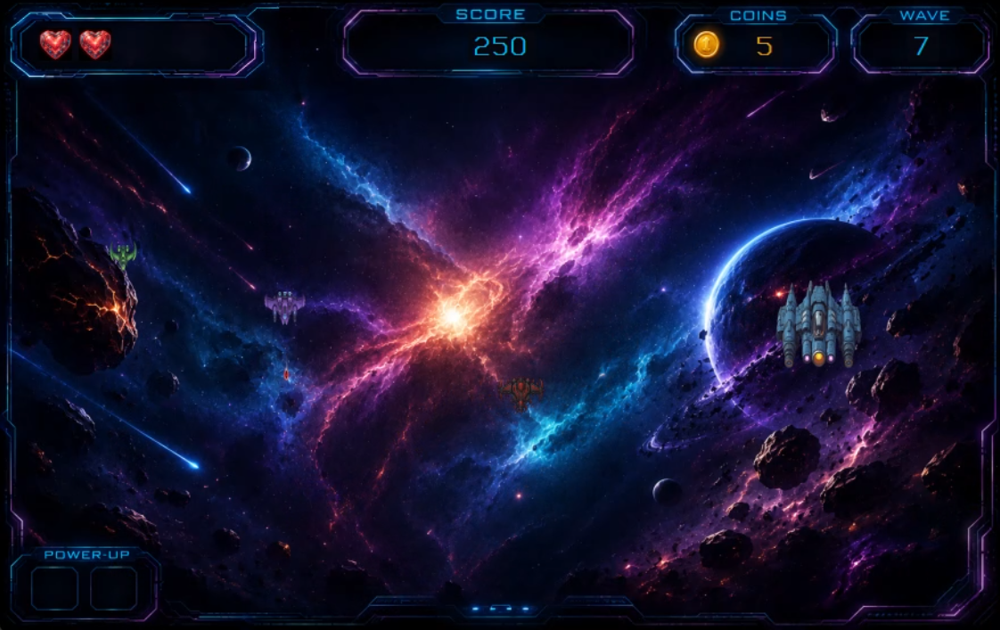
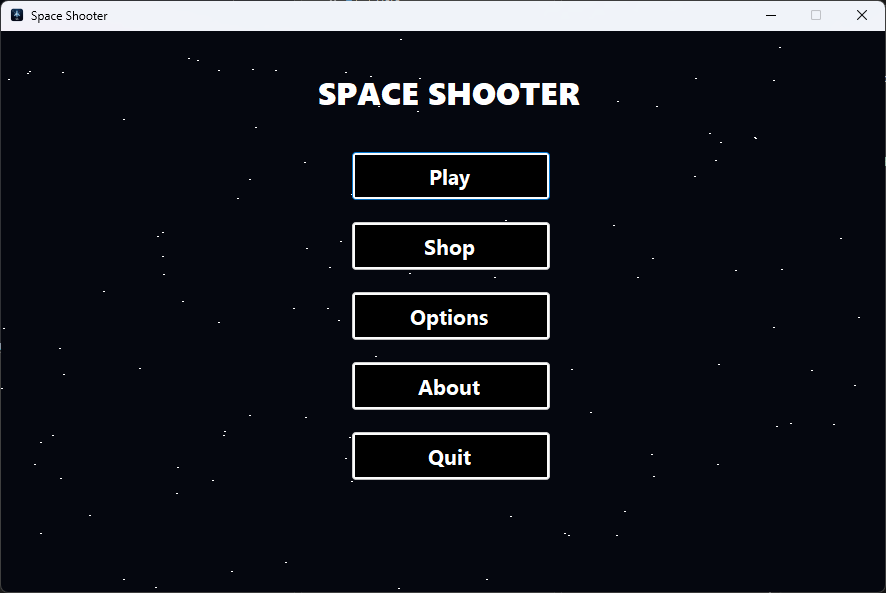
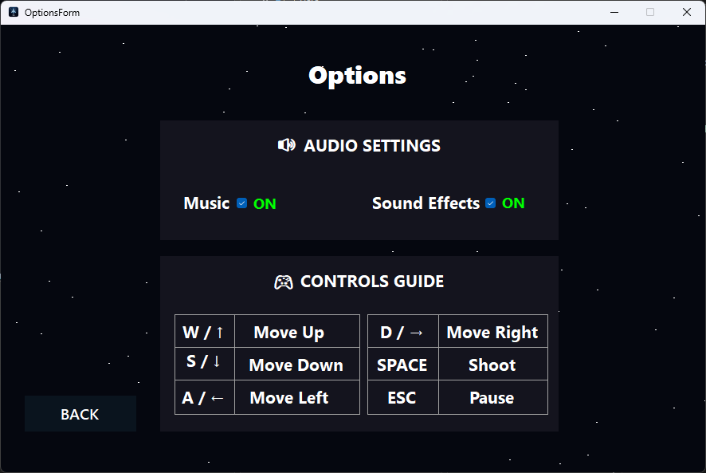
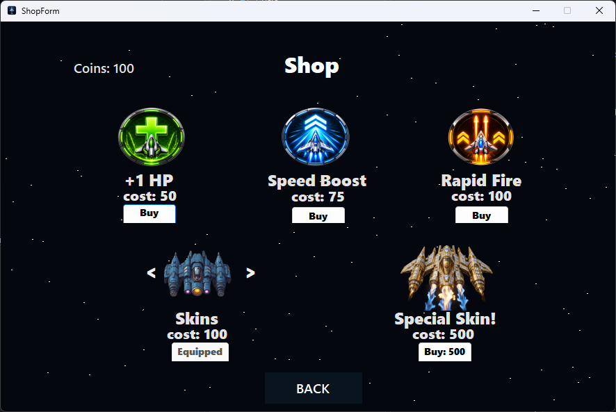

<div align="center">

# ✦ SPACE SHOOTER

### From a C# learning project to a universe of its own.

**An object-oriented space shooter, built from scratch with C# and Windows Forms — now presented through an interactive, playable web experience.**

[](https://amirhosein5969.github.io/SpaceShooter-Game/)
[](https://dotnet.microsoft.com/)
[](https://nextjs.org/)
[](https://pages.github.com/)

<br />

**[Explore the live experience ↗](https://amirhosein5969.github.io/SpaceShooter-Game/)** · **[Meet the developer](#-the-developer)** · **[فارسی](#-معرفی-پروژه)**

<br />



</div>

## 🚀 The project

Space Shooter is a Windows desktop game I created while learning C#. I built its gameplay systems, enemy behaviors, wave progression, player upgrades, shop, audio controls, login flow and persistent player data from the ground up.

The repository now also includes a dedicated interactive showcase. It tells the story behind the game as you scroll, then lets visitors launch a browser-based playable preview and experiment with its settings.

## ✨ Explore the experience

| Chapter | What you will discover |
| --- | --- |
| **01 — The world** | Space environment, player ships, enemy fleet, coins and power-ups. |
| **02 — Architecture** | Object-oriented entities, individual enemy behaviors and wave progression. |
| **03 — Game logic** | The game loop, movement, collision detection, health, scoring and drops. |
| **04 — The result** | Login, shop, upgrades, audio and persistent player progress. |
| **05 — Player lab** | A playable browser demo with live difficulty, ship, speed, health and audio settings. |

### The original game

<div align="center">

| Main menu | Audio settings | In-game shop |
|:---:|:---:|:---:|
|  |  |  |

</div>

## 🧩 Technology

**Desktop game:** C#, .NET 10, Windows Forms, SQLite, NAudio.

**Interactive showcase:** Next.js 15, React 19, TypeScript, HTML Canvas and custom CSS animations.

**Publishing:** GitHub Actions and GitHub Pages.

## ▶️ Run locally

### Interactive website

Requirements: Node.js 22 or later.

```bash
npm ci
npm run dev
```

Open [http://localhost:3000](http://localhost:3000).

To create the production static export:

```bash
npm run typecheck
npm run build
```

The generated website is written to `out/`.

### Original Windows game

Open `Final_Ap_Project/Final_Ap_Project.slnx` in Visual Studio with the .NET 10 Windows desktop workload, restore NuGet packages and run the `Final_Ap_Project` project.

## 🎮 Controls

| Action | Key |
| --- | --- |
| Move | W / A / S / D or arrow keys |
| Shoot | Space |
| Return / pause menu | Esc |

## 🧠 About the player lab

The web playground is a lightweight browser simulation inspired by the original game's mechanics and visual assets. It supports live ship selection, movement speed, firing interval, starting health, difficulty, music, sound effects and visual effects.

The prediction panel is a transparent local heuristic demo. It estimates difficulty and survival from the selected settings and the visitor's prompt; it does not call an external AI model or claim to predict a completed real gameplay session.

## 🌐 Deployment

The `Deploy Space Shooter showcase` workflow builds and publishes the static Next.js export to GitHub Pages whenever changes reach `main`. The repository's Pages publishing source must be set to **GitHub Actions** in Settings → Pages.

**Live website:** https://amirhosein5969.github.io/SpaceShooter-Game/

## 👨‍🚀 The developer

<div align="center">

### Amirhossein Rezaaie

I enjoy turning ideas into working software, exploring new technologies and learning by building real projects.

This academic project was developed with contributions from **Amirhossein Ebrahimpoor**.

[](https://github.com/AmirHosseinRezaaie)
[](https://amirhosseinrezaaie.github.io/CW_project_Resume-Web-Page/)

| Contact | Link |
| --- | --- |
| Telegram | [@amirhossein122333](https://t.me/amirhossein122333) |
| WhatsApp | [Message me](https://wa.me/qr/DXZSKFSOLGCMH1) |
| Eitaa | [@amirhossein122333](https://eitaa.com/amirhossein122333) |
| Email | [ah.rezaaie@gmail.com](mailto:ah.rezaaie@gmail.com) |
| Instagram | [@amir_hosein122333](https://instagram.com/amir_hosein122333) |

</div>

---

<div dir="rtl">

## ✦ معرفی پروژه

**Space Shooter** یک بازی سفینه‌ای برای ویندوز است که در مسیر یادگیری زبان #C از صفر طراحی و پیاده‌سازی کردم. معماری شیءگرا، رفتار اختصاصی دشمن‌ها، سیستم موج‌ها، مدیریت برخورد، جان و امتیاز، فروشگاه، ارتقای سفینه و ذخیره اطلاعات بازیکن، بخش‌هایی از این تجربه هستند.

در کنار بازی اصلی، یک وب‌سایت تعاملی هم برای نمایش روند ساخت آن آماده شده است. با اسکرول، فصل‌های مختلف پروژه را می‌بینی و در آزمایشگاه پایانی می‌توانی بازی را اجرا کنی، تنظیمات را تغییر بدهی و نتیجه را همان لحظه مشاهده کنی.

**[ورود به وب‌سایت پروژه ↗](https://amirhosein5969.github.io/SpaceShooter-Game/)**

### بخش‌های پروژه

- طراحی جهان بازی، پس‌زمینه و سفینه‌های قابل انتخاب
- پنج نوع دشمن با رفتارها و ویژگی‌های متفاوت
- مدیریت موج‌ها و افزایش تدریجی سختی بازی
- حلقه بازی، شلیک، برخورد، جان، امتیاز و آیتم‌های ویژه
- ورود بازیکن، فروشگاه، ارتقا و ذخیره‌سازی SQLite
- موسیقی پس‌زمینه و کنترل افکت‌های صوتی
- آزمایشگاه تعاملی نسخه مرورگری

### ارتباط با سازنده

من **امیرحسین رضایی** هستم. خوشحال می‌شوم درباره پروژه‌ها، ایده‌ها و فرصت‌های همکاری گفت‌وگو کنیم.

- [گیت‌هاب](https://github.com/AmirHosseinRezaaie)
- [رزومه](https://amirhosseinrezaaie.github.io/CW_project_Resume-Web-Page/)
- [تلگرام](https://t.me/amirhossein122333) · [واتساپ](https://wa.me/qr/DXZSKFSOLGCMH1) · [ایتا](https://eitaa.com/amirhossein122333)
- [ایمیل](mailto:ah.rezaaie@gmail.com) · [اینستاگرام](https://instagram.com/amir_hosein122333)

</div>

<div align="center">

**Made with curiosity and a love for building games.** ✦

</div>
